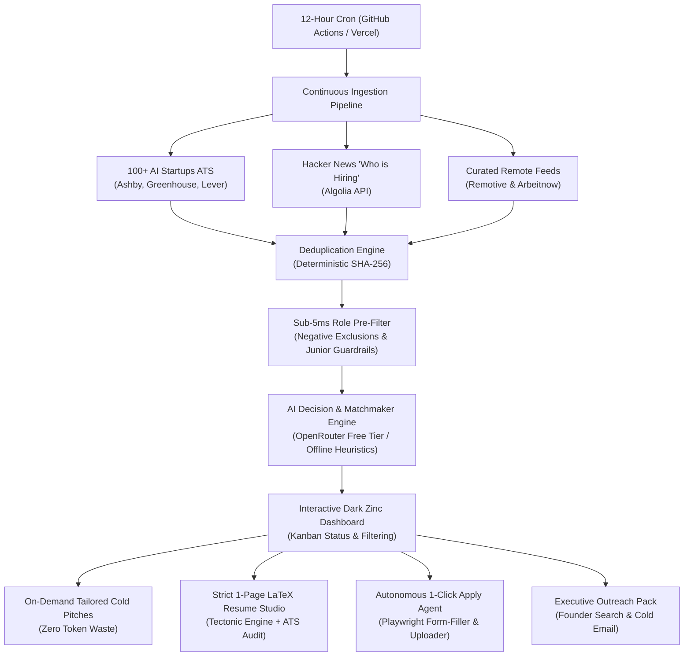

# JobScout AI 🚀
### Autonomous Startup Job Discovery, LaTeX Resume Tailoring & Agentic ATS Application Engine

[](https://nextjs.org/)
[](https://www.typescriptlang.org/)
[](https://tailwindcss.com/)
[](https://playwright.dev/)
[](https://tectonic-typesetting.github.io/)
[](https://opensource.org/licenses/MIT)

**JobScout AI** is an autonomous pair-engineering platform that continuously discovers high-fit opportunities across 100+ top AI companies and tech startups, ranks roles for junior/fresher engineers (<2 YOE), compiles strict 1-page ATS-optimized LaTeX PDF resumes on demand, and autonomously completes multi-stage ATS job application forms via Playwright browser automation.

---

## 🌟 Key Architecture & Capabilities



---

## ⚡ Core Features

### 1. Ingestion Pipeline Across 100+ Top AI Companies
- **Unauthenticated Public ATS Connectors**: Queries public JSON feeds for **Ashby** (`jobs.ashbyhq.com`), **Greenhouse** (`boards-api.greenhouse.io`), and **Lever** (`api.lever.co`) directly without API keys.
- **Top 100 AI Ecosystem**: Pre-loaded with foundation model labs (*OpenAI, Anthropic, Mistral, Cohere, Perplexity*), developer infra (*Cursor/Anysphere, Modal, Together AI, Groq, Baseten, LangChain*), generative media (*Runway, Suno, ElevenLabs*), physical AI (*Figure AI, Skild AI*), and top Indian AI startups (*Sarvam AI, Krutrim, Atlan, InVideo*).
- **Hacker News Algolia Integration**: Ingests monthly hiring threads in real-time.
- **Deterministic Deduplication**: Computes SHA-256 hashes of `company + title + url` to prevent repeat processing across scan cycles.

### 2. Junior / Fresher (<2 YOE) Precision Filter
- **Positive Heuristics**: Prioritizes `Junior`, `Associate`, `New Grad`, `Early Career`, `Software Engineer I`, `L1`, `Founding Engineer`.
- **Negative Exclusions**: Automatically discards senior overhead postings (`Staff`, `Principal`, `Director`, `VP`, `Architect`, `Lead`, `8+ years`).
- **Location Intelligence**: High-priority classification for **Indian Tech Hubs** (*Bangalore, Hyderabad, Pune, Mumbai, Gurgaon, Noida*) and Worldwide Remote roles.

### 3. Strict 1-Page LaTeX Resume Engine & ATS Audit
- **Tectonic Compilation**: Generates deterministic, publication-grade 1-page PDF resumes.
- **ATS Compliance Validator**:
  - Strict 1-page overflow check (enforces single-page ceiling).
  - Computer Modern OT1 ligature defense (prevents parser breakage on `fi`, `fl`, `ff`).
  - Action verb checker (validates strong ownership verbs like *built, architected, shipped, hardened*).
  - Dynamic project & skill ranking tailored to the target role.
- **Zero-Failure Bundled Fallback**: Includes pre-compiled master PDFs (`/public/resumes/`) ensuring cloud serverless environments never fail if Tectonic is omitted.

### 4. Autonomous 1-Click ATS Application Browser Agent
- **Playwright Automation**: Automatically navigates to external ATS application URLs, uploads the tailored 1-page PDF resume, fills candidate fields, and captures visual proof.
- **Complex Multi-Stage Form Solver**:
  - **Export Control (EAR / ITAR / U.S. Person)**: Intelligently resolves export administration questions (e.g. Cerebras Systems), selecting the compliant citizen status option.
  - **EEOC Demographics**: Auto-selects `Gender`, `Race / Ethnicity`, `Veteran Status`, and `Disability` compliance radios.
  - **Ashby Hidden Radio Resolution**: Triggers DOM click events and label targets to bypass CSS `opacity: 0` radio interception.
  - **Screening Questions & Textareas**: Contextually drafts answers for *"Why Us"*, *"Most Challenging Project"*, and technical background.
- **3 Operational Modes**:
  1. **Auto-Fill & Review (Recommended)**: Populates all fields, attaches PDF, solves questions, and captures full-page visual snapshot for human review.
  2. **Full Auto-Submit (Zero-Touch)**: Executes full submission and stores confirmation receipt.
  3. **Open in Chrome (Desktop)**: Launches a headed Google Chrome session with all fields pre-filled for manual verification or CAPTCHA resolution.

### 5. Manual Field Kit & Executive Outreach Pack
- **1-Click Field Copy**: Copy candidate details (Name, Email, Phone, GitHub, LinkedIn, Portfolio) to clipboard in 1 click.
- **Decision-Maker Discovery**: Direct pre-filtered query shortcuts for LinkedIn Founders and Engineering Leads.
- **Executive Cold Email Pack**: Tailored cold outreach templates citing open-source achievements (e.g. `neo-mcp` with 45+ PyPI releases, 1,300+ deterministic tests).
- **Follow-up Calendar Tracker**: Recommended 5-day polite follow-up reminder schedule.

### 6. On-Demand Cold Pitch Generator
- Generates tailored cold pitch hooks **only when clicked** by the user, saving 100% of LLM token costs for unscanned or irrelevant listings.

### 7. Observability & Traces Drawer
- High-fidelity live trace logger (`/api/traces`) tracking discovery, filter decisions, resume compilation times, and browser automation steps.

---

## 🛠 Tech Stack

- **Framework**: Next.js 16.3 (Turbopack, App Router, React 19)
- **Styling**: Tailwind CSS v4, shadcn/ui dark zinc aesthetic, Lucide React icons
- **Browser Automation**: Playwright Core with custom Chrome binary resolver
- **Resume Typesetting**: Tectonic LaTeX Engine
- **AI & Models**: OpenRouter API (`google/gemini-2.0-flash-exp:free`, `meta-llama/llama-3.3-70b-instruct:free`) with offline heuristic fallback
- **Data & Storage**: Serverless-compatible filesystem engine (`.data/` locally, `/tmp/.jobscout_data` on Vercel)

---

## 📂 Repository Structure

```
.
├── .github/
│   └── workflows/
│       └── job-scan-cron.yml         # 12-hour automated discovery cron workflow
├── public/
│   └── resumes/                      # Bundled master 1-page PDF resumes
├── scripts/
│   ├── test-all.ts                   # Core deduplication, heuristic, and connector tests
│   ├── test-auto-apply.ts            # Autonomous browser agent mock portal test
│   ├── test-resume-and-apply.ts      # LaTeX tailor engine & Tectonic compiler test
│   └── test-top-100-ai.ts            # Top 100 AI ATS slugs validation test
├── src/
│   ├── app/
│   │   ├── api/                      # Next.js API Routes (apply, cron, jobs, profile, resume, scan, traces)
│   │   ├── globals.css               # Dark zinc design system theme variables
│   │   ├── layout.tsx                # Root layout with Geist font configuration
│   │   └── page.tsx                  # Interactive JobScout Kanban Dashboard
│   ├── components/
│   │   ├── ui/                       # Accessible UI primitives (dialog, button, badge, input, tabs, card)
│   │   ├── ApplyModal.tsx            # 1-Click Autonomous Apply & Manual Field Kit modal
│   │   ├── AutonomousLoopBar.tsx     # Pipeline execution monitor bar
│   │   ├── DashboardHeader.tsx       # Live stats counter, manual scan button, profile trigger
│   │   ├── FilterBar.tsx             # Text search, source filters, match score slider, ecosystem chips
│   │   ├── JobCard.tsx               # Rich job card with tailored resume preview & status controls
│   │   ├── JobDetailsModal.tsx       # AI assessment modal with specs and ATS portal link
│   │   ├── ProfileModal.tsx          # Candidate preferences, skills, and resume configuration
│   │   ├── ResumeTailorModal.tsx     # LaTeX source preview, Tectonic compiler, ATS audit report
│   │   ├── TraceDrawer.tsx           # Observability drawer for real-time pipeline logs
│   │   └── WatchlistModal.tsx        # Top 100 AI companies directory and ATS slug tracker
│   ├── lib/
│   │   ├── ai/                       # OpenRouter client & decision prompt templates
│   │   ├── apply/                    # Playwright browser agent, application assistant, resume helper
│   │   ├── connectors/               # Ingestion connectors (Ashby, Greenhouse, Lever, HN, Remotive, Arbeitnow)
│   │   ├── data/                     # Top 100 AI companies directory dataset
│   │   ├── resume/                   # LaTeX compiler, ATS audit rules, template engines
│   │   ├── tracing/                  # Persistent structured logger and trace store
│   │   ├── pipeline.ts               # Core scan, filter, and score orchestrator
│   │   ├── storage.ts                # Serverless JSON storage with /tmp failover
│   │   └── utils.ts                  # ClassName merging and writable data directory resolver
│   └── types/                        # TypeScript domain definitions
├── .env.example                      # Documented environment variables template
├── vercel.json                       # Vercel cron and deployment specification
└── package.json
```

---

## 🚀 Quickstart & Local Development

### 1. Prerequisites
- **Node.js**: v18.0.0 or later (tested on Node v20/v24)
- **Google Chrome**: Installed in `/Applications/Google Chrome.app` (macOS) or `/usr/bin/google-chrome` (Linux) for autonomous browser automation.
- **Tectonic** *(Optional for local LaTeX compilation)*:
  ```bash
  brew install tectonic  # macOS
  # or: curl --proto '=https' --tlsv1.2 -fsSL https://drop-sh.fullyjustified.net | sh
  ```

### 2. Setup
```bash
# Clone the repository
git clone https://github.com/Dakshjain1604/Job-Search-and-Application-Autonomous-Agentic-System.git
cd Job-Search-and-Application-Autonomous-Agentic-System

# Install dependencies
npm install

# Setup environment variables
cp .env.example .env.local
```

### 3. Run Development Server
```bash
npm run dev
```
Navigate to [http://localhost:3000](http://localhost:3000) to view the dashboard.

### 4. Run Test Suite
```bash
npm test
```
Executes all 3 verification suites:
1. `test-all.ts`: Tests deduplication, heuristic matching, negative filters, and live ATS endpoints.
2. `test-resume-and-apply.ts`: Tests LaTeX tailoring, Tectonic compilation, and application kit generation.
3. `test-auto-apply.ts`: Launches mock ATS server, executes Playwright browser agent in preview and submit modes.

---

## ⚙️ Environment Variables

Configure these in `.env.local` (local) or **Project Settings > Environment Variables** (Vercel):

| Variable | Required | Description |
| :--- | :---: | :--- |
| `OPENROUTER_API_KEY` | Optional | OpenRouter API Key for free LLMs (`google/gemini-2.0-flash-exp:free`, `meta-llama/llama-3.3-70b-instruct:free`). If omitted, uses offline heuristic matching. |
| `CRON_SECRET` | Recommended | Secret token to authenticate `/api/cron/scan` triggers via `Authorization: Bearer <token>`. |
| `JINA_API_KEY` | Optional | Free Jina Reader token for parsing arbitrary careers web pages. |
| `VERCEL_PROJECT_URL` | Optional | Deployment URL (e.g. `https://your-jobscout.vercel.app`) used by GitHub Actions cron. |
| `CHROME_PATH` | Optional | Override executable path for Google Chrome or Chromium. |

---

## ☁️ Deploying to Vercel

1. Push your changes to GitHub.
2. Import the repository into [Vercel](https://vercel.com/new).
3. Under **Environment Variables**, add:
   - `CRON_SECRET`: Generate a secure random token (e.g. `openssl rand -hex 16`).
   - `OPENROUTER_API_KEY`: *(Optional)* Your OpenRouter key.
4. Click **Deploy**.

> [!NOTE]
> - On Vercel serverless environments, file storage automatically uses `/tmp/.jobscout_data` to ensure zero filesystem permission errors.
> - The application includes pre-bundled master PDF resumes in `/public/resumes/` to ensure PDF preview and downloads work smoothly on cloud instances without requiring a native Tectonic install.
> - For full autonomous browser form-filling (launching your desktop Chrome session with live screen automation), run JobScout locally via `npm run dev`. On cloud deployments, use the **Manual Field Kit** (1-click clipboard copy) and **Open Official ATS** button.

### Enabling 12-Hour Automated Scans via GitHub Actions:
Vercel Hobby tier limits built-in cron jobs to once per 24 hours. The included `.github/workflows/job-scan-cron.yml` workflow triggers scans every 12 hours (`0 0,12 * * *`) completely free:
1. In your GitHub repo, go to **Settings > Secrets and variables > Actions**.
2. Add:
   - `VERCEL_PROJECT_URL`: Your Vercel domain (e.g. `https://jobscout.vercel.app`).
   - `CRON_SECRET`: Same value configured in your Vercel project.

---

## 📡 API Reference

| Endpoint | Method | Description |
| :--- | :---: | :--- |
| `/api/scan` | `POST` | Triggers on-demand job discovery and AI matchmaking. |
| `/api/cron/scan` | `POST` | Authenticated 12-hour cron endpoint (`Authorization: Bearer <CRON_SECRET>`). |
| `/api/jobs` | `GET` | Fetches filtered job listings with match scores and status. |
| `/api/jobs` | `PATCH` | Updates listing status (`NEW`, `SAVED`, `APPLIED`, `INTERVIEWING`, `ARCHIVED`) and notes. |
| `/api/jobs/pitch` | `POST` | Generates or regenerates an on-demand tailored cold outreach note. |
| `/api/resume/tailor` | `POST` | Generates tailored 1-page LaTeX source and ATS audit score for a job. |
| `/api/resume/compile` | `POST` | Compiles LaTeX code to a downloadable PDF via Tectonic. |
| `/api/apply/generate` | `POST` | Creates the candidate Field Kit and executive outreach pack. |
| `/api/apply/auto-submit` | `POST` | Launches the Playwright browser agent (`preview`, `submit`, or `headed`). |
| `/api/profile` | `GET` / `POST` | Manages candidate profile, target roles, experience level, and skills. |
| `/api/watchlist` | `GET` / `POST` | Manages tracked company ATS slugs (`ashby`, `greenhouse`, `lever`). |
| `/api/stats` | `GET` | Returns aggregated metrics on scanned, high-match, saved, and applied roles. |
| `/api/traces` | `GET` | Retrieves real-time pipeline execution traces and error logs. |

---

## 👤 Author & Contributor

- **Daksh Jain** ([@Dakshjain1604](https://github.com/Dakshjain1604))
  - AI & Full-Stack Engineer
  - Author of [neo-mcp](https://github.com/Dakshjain1604) (45+ releases on PyPI & npm, 700+ tests, Claude Code & Cursor integration)
  - Portfolio: [portfolio-dakshjain.vercel.app](https://portfolio-dakshjain.vercel.app)
  - LinkedIn: [linkedin.com/in/daksh-jain16](https://linkedin.com/in/daksh-jain16)

---

## 📄 License

This project is licensed under the MIT License - see the [LICENSE](LICENSE) file for details.
